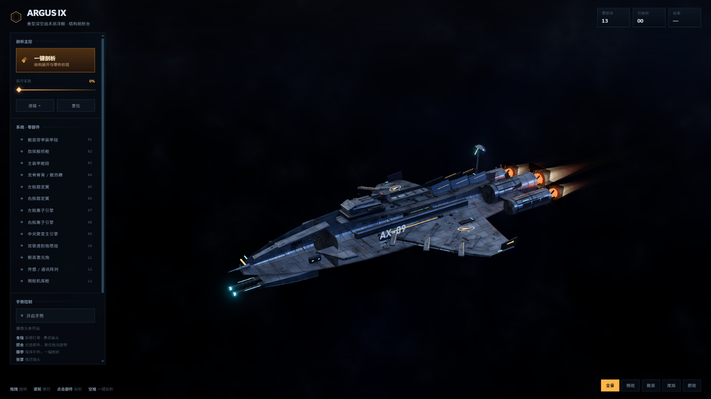
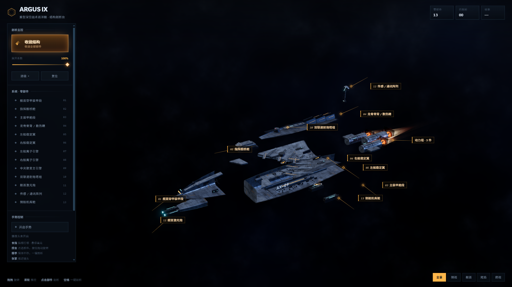
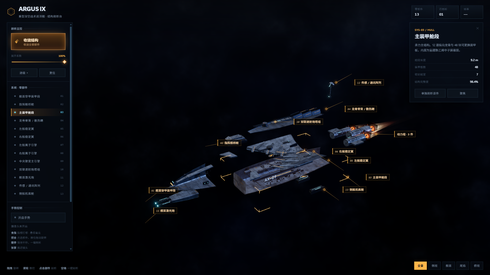
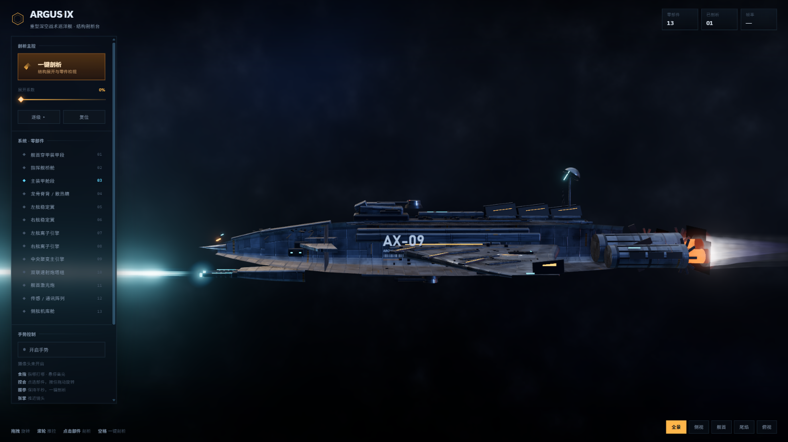
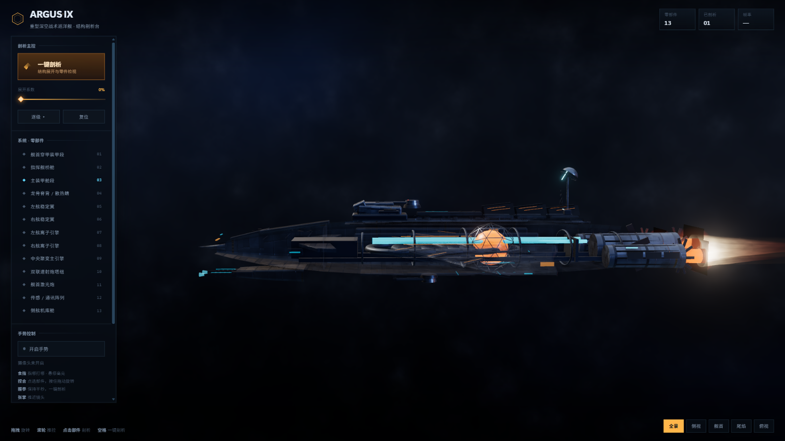
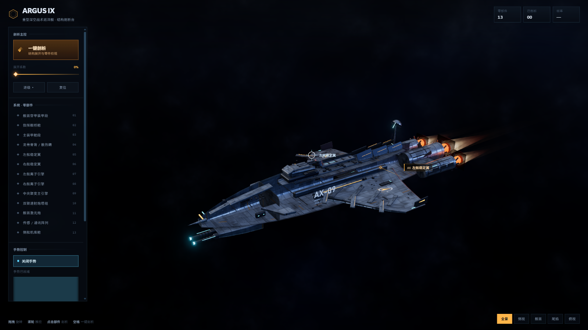
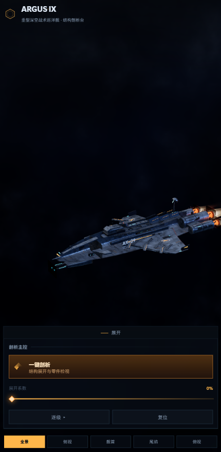

<div align="center">

# ARGUS-IX

**深空战术巡洋舰 · 可剖析的结构展示台**

一艘没有模型文件的宇宙飞船 —— 每一块装甲、每一台引擎都由代码程序化生成。

[](https://threejs.org/)
[](#技术栈)
[](https://ai.google.dev/edge/mediapipe/solutions/vision/hand_landmarker)
[](#隐私与离线)
[](LICENSE)

</div>

<div align="center">
  
</div>

---

## 这是什么

一个纯前端的三维飞船展示页，重点不是"能转的飞船"，而是**把飞船拆开看**。

点击一次，13 个部件各自沿预定方向分离，镜头自动拉远避开面板，引线标签标注每一个部件。
再点击任意部件，弹出材质、尺寸与性能参数卡。

没有 `.glb`，没有贴图文件，没有构建步骤。
船体是圆角矩形截面沿轴放样出来的，机翼是同款截面沿展向放样得到的翼型，尾焰是 GPU 上跑的湍流噪声。

## 亮点

| | |
|:--|:--|
| **一键剖析** | 13 个部件展开，每件 35 ms 级联延迟，整体 1.5 s 缓动 |
| **零件检视** | 点击部件弹出参数卡，左侧列表记录剖析进度 |
| **尾焰与激光** | 湍流等离子体着色器，可切换双联激光齐射 |
| **X 光透视** | 壳体半透明，露出聚变堆、燃料环舱与横向隔框 |
| **摄像头手势** | 裸手指哪打哪、捏合点选、握拳剖析、张掌推近 |
| **全离线** | three 与 MediaPipe 全部 vendor 在仓库内，运行时不联网 |

## 效果

<table>
<tr>
<td width="50%"><br><sub><b>一键剖析</b> — 部件带引线标签展开，同组自动合并</sub></td>
<td width="50%"><br><sub><b>零件检视</b> — 角标框 + 参数卡 + 列表进度</sub></td>
</tr>
<tr>
<td><br><sub><b>激光武器</b> — 双联齐射，尾焰转为离子蓝紫</sub></td>
<td><br><sub><b>X 光透视</b> — 内部反应堆与隔框显形</sub></td>
</tr>
<tr>
<td><br><sub><b>手势控制</b> — 准星跟随食指，悬停即高亮</sub></td>
<td><br><sub><b>移动端</b> — 面板收进可展开的底部抽屉</sub></td>
</tr>
</table>

## 快速开始

ES Module 需要 HTTP 协议，双击 `index.html` 不会工作。

```bash
git clone https://github.com/cslkkl/starship-anatomy.git
cd starship-anatomy
node server.mjs 4173
```

打开 http://127.0.0.1:4173/

**前置条件**

- Node 24+（只用它起静态服务，不参与构建）
- 无需 `npm install` —— `three` 已 vendor 在仓库内
- 也可以用 `npx serve .` 或 `python -m http.server` 替代

## 操作

**键盘**

| 键 | 作用 | 键 | 作用 |
|:--|:--|:--|:--|
| `空格` | 一键剖析 / 收拢 | `R` | 复位 |
| `E` | 逐级展开（4 档） | `F` | 聚焦选中部件 |
| `P` | 导出 PNG 截图 | `Esc` | 关闭检视卡 |

**鼠标**

- 拖拽旋转 · 滚轮推拉 · 右键平移 · 点击部件检视

**摄像头手势**

左面板底部点「开启手势」，允许摄像头后生效。

| 手势 | 作用 |
|:--|:--|
| 食指指向 | 屏幕准星跟随指尖，指到哪个部件就高亮哪个 |
| 拇指捏合 | 准星停在部件上捏一下即选中；按住移动则拖拽旋转 |
| 握拳（保持 0.55 s） | 一键剖析 / 收拢 |
| 张开手掌 | 持续推近镜头 |

## 技术栈

| 层 | 做法 |
|:--|:--|
| 渲染 | three.js r187，WebGL2，无构建步骤，importmap 直接跑 |
| 几何 | 程序化建模：截面放样、展向放样、轮廓挤出、greeble 合批 |
| 材质 | PBR + Canvas 程序化贴图（颜色 / 粗糙度 / 由高度图生成的法线） |
| 光照 | 手工搭建的自发光面板场景经 PMREM 生成环境贴图，不用 HDR 文件 |
| 后处理 | GTAO → UnrealBloom → OutputPass，ACES Filmic 色调映射 |
| 特效 | 自定义 ShaderMaterial：湍流尾焰、马赫盘激波、加法混合激光 |
| 手势 | MediaPipe HandLandmarker，GPU 优先、失败回退 CPU |
| 排版 | 系统字体单族（Segoe UI Variable），无网络字体 |

## 目录结构

```
starship-anatomy/
├── index.html          # 页面骨架 + HUD + importmap
├── server.mjs          # 零依赖静态服务器
├── css/style.css       # HUD 视觉系统
├── js/
│   ├── main.js         # 渲染器、后处理、拾取、UI 接线
│   ├── ship.js         # 程序化建模：13 个部件的几何与材质
│   ├── camera-rig.js   # 取景适配（HUD 安全区）、机位、飞行
│   ├── exploder.js     # 剖析状态机
│   ├── labels.js       # 引线标签、防重叠、同组合并
│   ├── gesture.js      # 手势 → 页面动作
│   ├── hands.js        # MediaPipe 手部追踪
│   ├── vfx.js          # 尾焰、激光、枪口闪光
│   ├── env.js          # 星云背景、星场、全息网格
│   ├── textures.js     # Canvas 程序化贴图
│   └── util.js         # 缓动、阻尼、确定性随机
├── vendor/             # three r187 + MediaPipe（离线可用）
├── models/             # hand_landmarker.task
└── docs/               # 架构说明
```

## 性能

在 RTX 4060 / 2000×1125 分辨率下：

- 静态视角 190–235 fps
- 展开后再开启 GTAO 与 Bloom，仍在 100 fps 以上
- 全舰约 40 个 draw call（按材质合批）

帧率读数在浏览器限流（后台标签页、无头环境）时显示 `—`，这是刻意为之。

## 隐私与离线

- 3D 渲染、贴图生成、手势识别全部在本机运行。
- 摄像头画面不出浏览器，不录制、不保存、不上传。
- 运行时零网络请求 —— three 与 MediaPipe 的 WASM 和模型都是本地文件。

## 文档

- 架构设计与防错清单 → [docs/ARCHITECTURE.md](docs/ARCHITECTURE.md)
- 模块索引与变更路由 → [js/README.md](js/README.md)
- 维护者文档地图 → [AGENTS.md](AGENTS.md)

## 第三方与许可

本仓库代码基于 [MIT License](LICENSE) 开源，可自由使用、修改与分发。

`vendor/` 与 `models/` 内含 three.js（MIT）与 MediaPipe（Apache-2.0）资源，
版权归各自上游项目，详见 [THIRD-PARTY-NOTICES.md](THIRD-PARTY-NOTICES.md)。

<div align="center"><sub>ARGUS-IX · 船体编号 AX-09 · 全舰由代码构建</sub></div>
